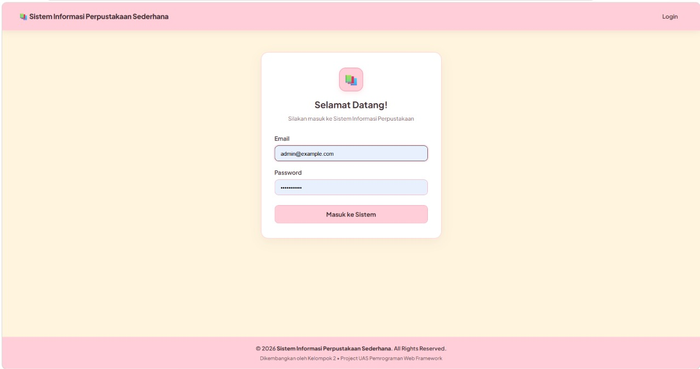
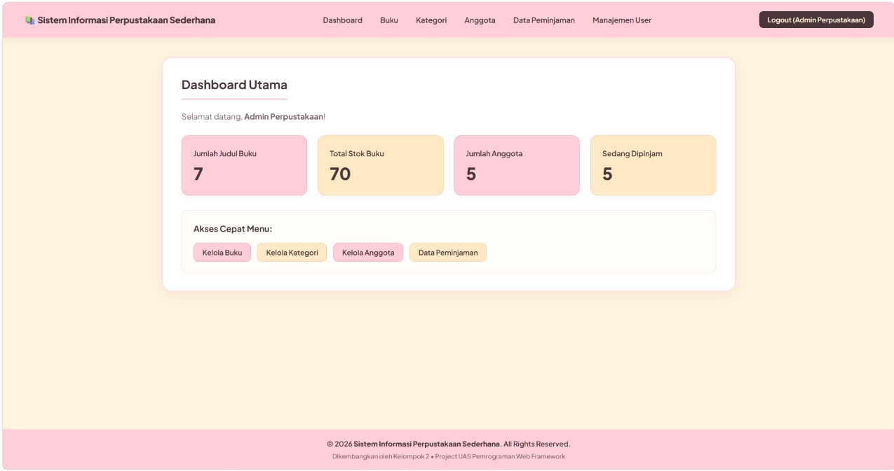
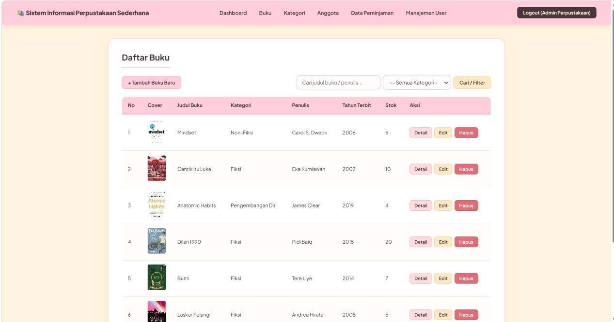
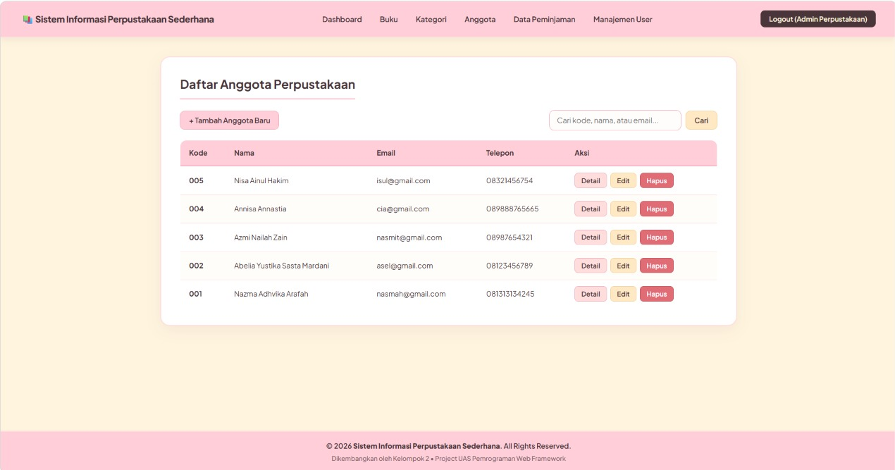
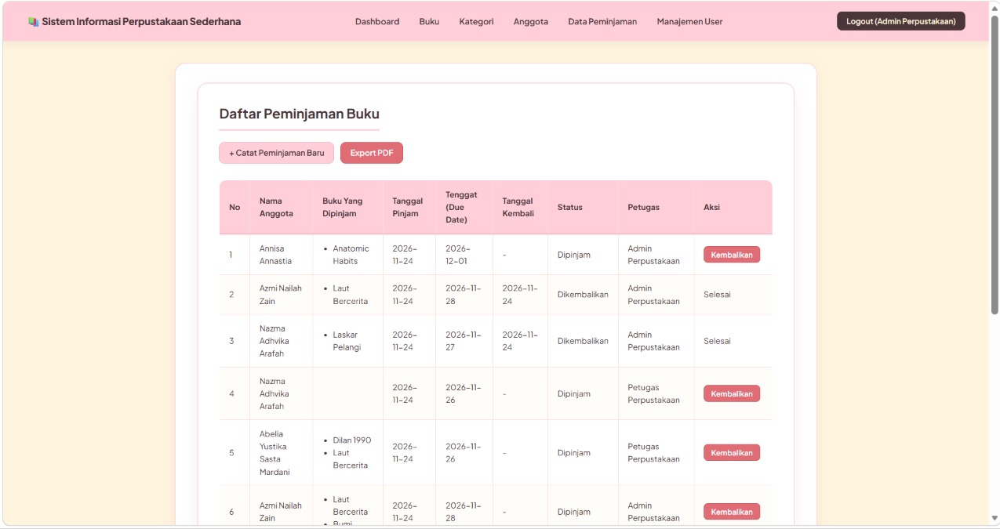

# Sistem Informasi Perpustakaan Sederhana

## Deskripsi Aplikasi
**Sistem Informasi Perpustakaan Sederhana** merupakan aplikasi web berbasis Laravel yang dikembangkan untuk membantu pengelolaan data buku, kategori, anggota, pengguna, serta transaksi peminjaman dan pengembalian buku secara terstruktur dan efisien.

Proyek ini dibuat untuk memenuhi tugas Final Project mata kuliah **Pemrograman Web Framework**.

## Fitur Aplikasi
- **Login & Logout:** Autentikasi pengguna untuk masuk dan keluar dari sistem.
- **Dashboard:** Ringkasan statistik dan informasi utama perpustakaan.
- **Hak Akses (Admin & Petugas):** Pengelolaan akun pengguna dan pembatasan hak akses berdasarkan role (Admin dan Petugas).
- **Pengelolaan Kategori:** Tambah, ubah, dan hapus data kategori buku.
- **Pengelolaan Buku:** CRUD data buku, upload gambar cover buku, pengelolaan stok otomatis, serta halaman **Detail Buku**.
- **Pengelolaan Anggota:** Tambah, ubah, dan hapus data anggota perpustakaan.
- **Pengelolaan Peminjaman & Pengembalian:**
  - Pencatatan peminjaman beberapa buku sekaligus dalam satu transaksi.
  - **Validasi Batas Peminjaman:** Maksimal **3 buku** per transaksi dan maksimal **3 buku aktif** yang sedang dipinjam per anggota.
  - **Validasi Duplikasi:** Mencegah anggota meminjam judul buku yang sama selama buku tersebut masih berstatus *Dipinjam*.
  - **Pengembalian Otomatis:** Memperbarui status menjadi *Dikembalikan*, mencatat tanggal kembali (`return_date`), dan mengembalikan stok buku secara otomatis.
- **Laporan & Export PDF:** Cetak laporan data peminjaman buku lengkap (termasuk tanggal kembali) ke format PDF.

## Teknologi yang Digunakan
- PHP 8.3
- Laravel 13
- MySQL
- Composer 2.10
- HTML, CSS, Blade
- Git & GitHub

## Persyaratan Sistem
Sebelum menjalankan aplikasi ini secara lokal, pastikan perangkat telah terpasang:
- PHP >= 8.3
- Composer 2.10
- MySQL / MariaDB (XAMPP, Laragon, atau sejenisnya)
- Git
- Web Browser

## Instalasi dan Konfigurasi
1. Clone repository proyek dan masuk ke direktori proyek:
   ```bash
   git clone https://github.com/2410631250025/perpustakaan-sederhana.git	
   cd perpustakaan-sederhana
composer install 
cp .env.example .env 
php artisan key:generate

Kemudian sesuaikan konfigurasi database pada .env. Setelah database disiapkan, jalankan: php artisan migrate --seed 
php artisan serve

Buka aplikasi melalui browser pada alamat http://127.0.0.1:8000 
Jika seeder tidak disiapkan atau tidak mencakup seluruh data awal, sesuaikan instruksi instalasi agar sesuai dengan kondisi proyeknya.

## Akun Demo
Berikut adalah akun khusus demonstrasi yang dapat digunakan untuk pengujian aplikasi:
Admin - admin@example.com - password123 
Petugas - petugas@example.com - password123 
## Screenshot Aplikasi
- **Halaman Login**
  
- **Halaman Dashboard**
  
- **Halaman Buku**
  
- **Halaman Anggota**
  
- **Halaman Peminjaman & Pengembalian**
  

## Anggota Kelompok
1. Abelia Yustika Sasta Mardani
2. Azmi Nailah Zain
3. Nazma Adhvika Arafah


